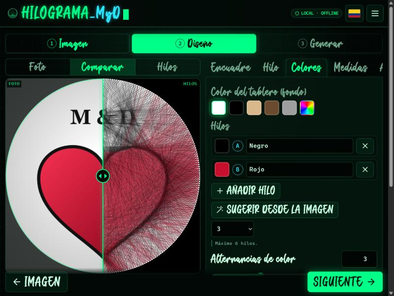
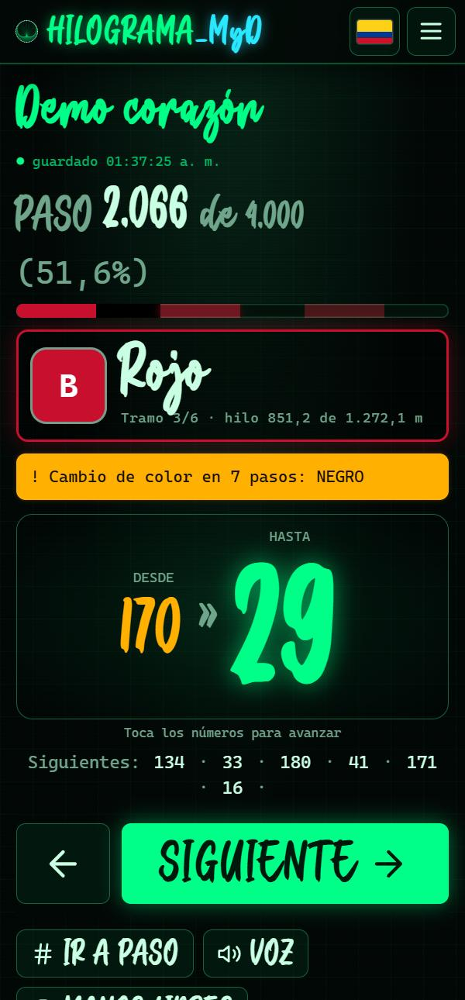

# HILOGRAMA_MyD

**Convierte una imagen en un hilograma (string art): clavos, hilo y números, 100 % en tu dispositivo.**

[English below](#english)

Hilograma MyD es una aplicación web instalable (PWA) que funciona en computador y en celular, sin
conexión y sin servidores. Calcula el orden en que hay que pasar el hilo entre los clavos de un marco
circular, cuántos metros de cada color hacen falta, y te guía paso a paso mientras tejes.

> Versión propia basada en **[StringArtGenerator](https://github.com/halfmonty/StringArtGenerator)**
> de **halfmonty** (licencia MIT), el repositorio de hilogramas con más estrellas en GitHub.
> Gracias a halfmonty y a /u/kmmeerts por el trabajo original. Detalles en [CREDITS.md](CREDITS.md).

| Diseño en vivo (foto \| hilos) | Manual paso a paso en el celular |
|---|---|
|  |  |

## Qué hace

1. **Imagen** – elige el modo y una foto (o tómala con la cámara). La app da **consejos para elegir la
   imagen** (cara de cerca, fondo claro, buena luz…) y avisa si la foto tiene demasiadas zonas oscuras.
   Se procesa solo en la memoria del dispositivo.
   - **Automático (recomendado):** solo eliges el estilo de color (clásico, invertido, a color desde la
     imagen o tus colores) y el diámetro del marco. Clavos, líneas, brillo y contraste se calculan solos
     para que el hilograma no quede oscuro.
   - **Avanzado:** todas las opciones de abajo. Al mover cada barra se explica qué cambia al subirla (▲)
     o bajarla (▼), con la nueva densidad estimada.
2. **Diseño** – directamente sobre la imagen:
   - arrastra para encuadrar, pellizca o usa la rueda para hacer zoom, gira 90°;
   - brillo, contraste y saturación;
   - **vista previa en vivo del hilo**: grosor (mm) y opacidad (%) se ven al instante, con una barra
     para comparar *foto | hilos* sobre la misma imagen;
   - **colores**: color del tablero y hasta 6 hilos (o *Sugerir desde la imagen*); alternancias de color;
   - **medidas en cm**: diámetro del marco, número y grosor de los clavos, margen y amarres.
     La tabla muestra **líneas y metros de cada hilo** (neto y a comprar) y la separación entre clavos;
   - **densidad del hilo** (ligera, ideal, alta, muy alta) para saber antes de tejer si quedará oscuro.
3. **Generar** – modo *Normal* o *Sorpresa*, contraseña opcional, y archivo `.hilo` para Descargas.

Después, el **manual paso a paso**:

- número de paso grande, **DESDE → HASTA** (clavo), los siguientes clavos y un aro con la numeración;
- **cambios de color imposibles de pasar por alto**: aviso 15 pasos antes y una pantalla completa con el
  color, su letra (A, B, C…) y qué hacer ("ata y corta el hilo negro en el clavo 259; toma el rojo…");
- el avance se **guarda en cada paso** en el dispositivo; respaldos `.hilo` automáticos en **Descargas**
  (cada 100/250/500/1000 pasos) o con el botón *Respaldo*;
- voz que dicta el siguiente clavo, pantalla siempre encendida, teclado (espacio o → siguiente,
  ← anterior), *ir a paso*, plan de colores;
- **manos libres**: pantalla despejada con botones grandes *Atrás · Pausar/Continuar · Adelante*,
  velocidad de 2 a 30 s por paso, cuenta regresiva y tiempo restante; se detiene solo en los cambios de
  color (tecla P para pausar);
- en el inicio, **Continuar donde quedaste** abre el último proyecto en su paso.

### Guía para armar el marco

Desde el resultado, el manual o la pestaña *Medidas*, el botón **Guía del marco** calcula todo lo
necesario con las medidas reales del proyecto:

- **número de clavos** (y cuántos comprar con repuestos), **diámetro y radio** del círculo,
  **distancia entre clavos vecinos** en línea recta y por el arco, espacio libre entre ellos y
  **ángulo entre clavos**;
- **tablero** recomendado (tamaño y grosor), **clavo o puntilla** (grosor × largo, cuánto se entierra) y
  **altura sobre el tablero**, calculada con el número real de vueltas de hilo que recibe cada clavo;
- qué clavo va **arriba**, abajo y a la izquierda, para colgar el cuadro igual que la imagen;
- esquema de frente y de lado, lista de **materiales** (con los metros de cada hilo) y **herramientas**,
  **12 pasos** numerados y una **tabla de comprobación** de distancias entre clavos;
- **plantilla PDF a escala real** dividida en hojas Carta o A4, con cruces para unirlas, línea de corte y
  una barra de 10 cm en cada hoja para comprobar que se imprimió al 100 %; también **SVG en una sola
  pieza** (para imprenta) y **coordenadas CSV** de cada clavo.

### Modo sorpresa

Quien elige la imagen la ajusta y la previsualiza; al **sellar**, la imagen y el resultado se borran de
la memoria. El archivo `.hilo` solo lleva números, colores y medidas. Quien lo abre en **su propio
dispositivo** ve únicamente el manual: nunca el dibujo, hasta terminar el último paso (*Revelar la sorpresa*).

### Opciones del programa original que se conservan

Número de clavos (288), número de líneas (4000), peso de línea (20), distancia mínima, clavos recientes
a evitar, resolución, pegar una secuencia ya generada, los 3 ejemplos, *Solo dibujar* y el paso a paso con
teclado. Las secuencias de un solo color son compatibles con el formato del original.

## Cómo usarla

- **En línea (recomendado):** publica la carpeta con GitHub Pages y abre la URL en el computador o en el
  celular; usa *Instalar app* para tenerla como aplicación y sin conexión.
- **En tu computador:** desde esta carpeta ejecuta el servidor local incluido (solo escucha en tu
  equipo, sin caché y con las mismas cabeceras de seguridad que en producción) y abre `http://localhost:8642`:

  ```
  python tools/serve.py
  ```

  Abrir `index.html` con doble clic también funciona, pero el cálculo va en el hilo principal y el cifrado
  puede no estar disponible (el navegador lo exige en https o localhost).

## Seguridad y privacidad

Sin servidores, sin cuentas, sin cookies, sin analítica, sin dependencias externas; CSP estricta con
Trusted Types; AES-256-GCM + PBKDF2 (600 000 iteraciones) opcional; validación estricta de archivos.
Lee [SECURITY.md](SECURITY.md) para el modelo de amenazas completo y sus límites.

## Estructura

```
index.html            pantallas (sin scripts ni estilos en línea)
css/app.css           estética hacker
js/engine.js          algoritmo (del original, reescrito) + multicolor + metros
js/worker.js          cálculo en segundo plano
js/editor.js          imagen, vista previa, colores, medidas
js/manual.js          paso a paso, guardado, respaldos, cambios de color
js/frame.js           guía del marco, plantilla PDF/SVG y coordenadas CSV
js/storage.js         formato .hilo, cifrado, validación, almacenamiento local
js/i18n.js, flags.js  español / inglés y banderas
sw.js, manifest       PWA sin conexión
tools/make-icons.js   genera los iconos (node tools/make-icons.js)
tools/serve.py        servidor local para probar la app
```

## Licencia

MIT, ver [LICENSE](LICENSE). Incluye la licencia MIT original de StringArtGenerator en
[`LICENSES/`](LICENSES/). La fuente «Present» (NJ Studio) **no** está cubierta por la licencia MIT.

---

## English

**Hilograma MyD** turns a picture into string art: a circular frame of pegs, one continuous thread per
colour, and the exact peg order. It is an installable web app (PWA) for desktop and phone that runs
offline, with no servers.

It is its own version of **[StringArtGenerator](https://github.com/halfmonty/StringArtGenerator)** by
**halfmonty** (MIT), the most-starred string art repository on GitHub, which builds on work by /u/kmmeerts.
See [CREDITS.md](CREDITS.md).

**Features:** framing, zoom, rotation and adjustments directly on the picture; live thread preview with
thickness (mm) and opacity (%) and a photo/threads compare slider; up to 6 thread colours plus board colour;
metres of each thread computed from the frame diameter and peg size in cm; numbered step-by-step manual
with full-screen colour-change prompts; progress saved on every step plus `.hilo` backups to Downloads;
voice, hands-free mode and keyboard control; a **frame-building guide** (peg count, spacing, angle, board,
nail size and height, materials, 12 steps, measurement check, and a real-scale PDF template tiled on Letter/A4
sheets plus one-piece SVG and CSV coordinates); **Surprise mode** (the
picture and result are erased when sealed, and the builder on another device only sees the manual);
optional AES-256-GCM encryption; Spanish (default, Colombian flag) and English (flags of English-speaking
countries). All options from the original are kept.

**Run locally:** `python tools/serve.py`, then open `http://localhost:8642`.
Security details: [SECURITY.md](SECURITY.md). License: MIT ([LICENSE](LICENSE)); the «Present» font is
not covered by it.
